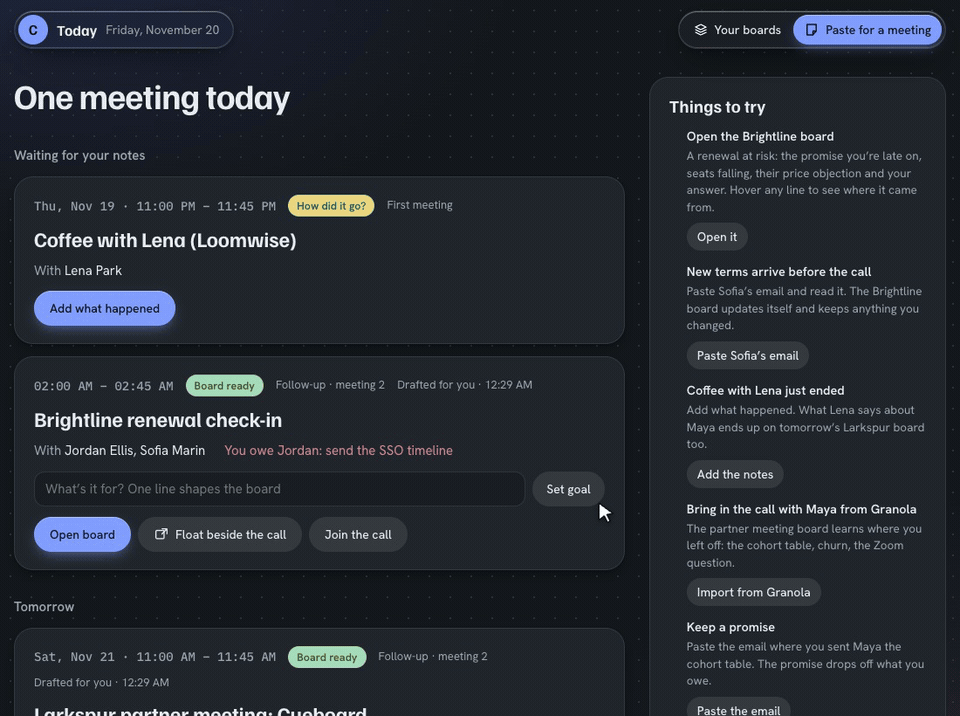

# Cueboard

**Visual prep for your next meeting.** Say in a line what a meeting is for, and Cueboard draws
how it should run: the goal across the top, the meeting's parts in order with their minutes,
and under each part what you need in it, from the people and their history to the numbers, the
questions to ask, the objections they raised and the promises still open. Every line says where
it came from. During the call, a small window floats over Zoom, Meet or Teams and follows along.



It works from what you already have: your calendar, your notes from past calls (pasted, or
imported from Granola), emails and invites. It remembers people, not transcripts, so the second
meeting with someone knows where the first one left off.

## Try it in two minutes, no key needed

```bash
git clone https://github.com/7mehul/cueboard.git && cd cueboard
npm install
node scripts/serve.ts 5190 --demo --fake-model
```

Open http://localhost:5190, choose **Load the demo week** in the boards menu, and open a board.
A founder's week is loaded: a renewal at risk, an investor partner meeting, a first sales call.
Type a goal in the bar at the top ("find out why seats are falling") and the board redraws
around it. `--fake-model` is a stand-in that only knows the demo's documents.

Needs Node 26 or later.

## Use it with Claude

Sign in once with the [ant CLI](https://platform.claude.com/docs/en/cli-sdks-libraries/cli/quickstart),
or set `ANTHROPIC_API_KEY`, then start the server without `--fake-model`:

```bash
ant auth login
node scripts/serve.ts            # http://localhost:5180
```

The key or sign-in stays in the server; the page never sees it. Every setting is listed in
[`.env.example`](.env.example).

## Where the context comes from

| Source | Status | What you need |
| --- | --- | --- |
| Your calendar, by its private link | Works, read-only | The link from Google, Outlook or Apple Calendar ([where to find it](#calendar-boards-without-asking)) |
| Google Calendar, by signing in | Works, read-only | Your own Google Cloud OAuth client ([setup](#calendar-boards-without-asking)) |
| Invite files (.ics) | Works | Drop or paste one on Today |
| Research on the people you meet | Works | Claude (it uses Claude's web search). On by default; switch it off on Today |
| Paste: invites, email threads, notes, transcripts | Works | Nothing. Paste several at once, or drop text files; each piece is sorted and dated |
| Granola notes | Works | A Granola Business plan API key |
| Your profile and goals | Works | Fill in "About you" once |
| Other notetakers (Fireflies, Fathom), Gmail, CRMs | Planned | |

## How it's built

Three parts:

- **The canvas** (`app/`): a freeform board, like Apple Freeform. Everything on it can be moved,
  resized, restyled, connected or deleted.
- **The board engine** (`src/`): drafts the starting arrangement from what's known about a meeting.
- **The judgment layer** (`src/intel/`): a model reads the meeting and decides what matters; the
  engine turns that into a board and checks it. Works with any model behind a small interface.

The engine only places things once. After that the board is the user's.

## The canvas

```bash
node scripts/serve.ts          # http://localhost:5180, rebuilds on every change
node scripts/build-app.ts      # one-off build to dist/cueboard.html (single file, publishable as a Claude artifact)
```

What you can do on it:

| Action | How |
| --- | --- |
| Add something | Dock at the bottom: note, text, card, person, checklist, shape, arrow, image, chart, number. Or double-click empty canvas for a note |
| Images | Paste one (⌘V), drop files onto the canvas, or use Image in the dock. Big images are scaled to 1800px; corners keep the proportions (Shift frees them) |
| Draw | Draw in the dock: pen, highlighter and eraser (P / H / E), six ink colors, three widths. Strokes drawn close together become one drawing you can move, resize and recolor. Esc or Done to stop |
| Select several | Drag across empty canvas, or Shift-click. ⌘A selects everything |
| Move, line up | Drag. Edges and centers snap to nearby items; hold Option/Alt to place freely. Arrow keys nudge (Shift for 10px) |
| Resize | Eight handles on whatever's selected; hold Shift on a corner to keep the proportions |
| Connect | Drag from a dot beside the selected item onto another, or add an arrow and drop its ends on things. Arrows follow when you move |
| Label an arrow | Double-click it, press Enter with it selected, or use Label in its toolbar. Enter saves, Esc cancels, an empty label removes it |
| Arrange | With several selected: align edges or centers, space evenly, bring to front or send to back |
| Group | ⌘G (or Group in the toolbar) makes the selection one item: clicking any member picks up the whole group, and it moves, aligns, copies and tidies as a block. Double-click a member to work on it alone, Esc to step back out. ⌘⇧G ungroups |
| Rotate | Drag the round handle above what's selected, or ⌘-drag a corner handle. It catches at 0°, 45° and 90°; Shift turns in 15° steps. Several items or a group turn around their shared center. Straighten resets the tilt |
| Copy | ⌘C / ⌘X / ⌘V, ⌘D to duplicate. Pasted text becomes a note |
| Move around | Scroll or trackpad to pan, pinch or ⌘-scroll to zoom, hold Space and drag |
| On a touchscreen | Drag empty canvas to pan; press and hold it, then drag, for a selection box. Press and hold an item to start selecting several, then tap more to add or remove them (or use Select more and Select all in the toolbar). Tap empty canvas to finish |
| During the meeting | Glance: read-only, tap to zoom, search, jump bar, timer, live notes |
| Beside the call | Float (or F) opens a small window that stays on top of Zoom, Meet or Teams in Chrome and Edge. It shows the board's own cards in one column, run of show first; controls appear when the pointer is over it. Click a card to see where each line came from (S shows every source; numbers always show theirs). / finds a name or number, ↑↓ move between cards, C shrinks it to one card with the goal and the next question in large type, N jots a note onto the board, T runs the timer, H shrinks it to a small pill with just the timer and Show. Other browsers get an ordinary window; where pop-ups aren't allowed it docks in the page corner |

Images live outside the board data: in the browser's IndexedDB locally, or in the artifact's asset
store when the page is published in Claude (that path isn't tested yet), so saved boards stay small.

The floating window only shows up for the other side if you share your entire screen; share a
window or a tab instead (it says so the first time it opens).

Lines the engine drafted keep a green bar if they came from a past meeting, a dashed box if
they're unknown, and the source they came from (hover a line, or click a card in Float). Rewriting a line makes it yours and removes the marker. New boards can start from
the sample meetings (boards menu → New board from a meeting) until real meeting data is connected.

## The goal and the plan

Every meeting is for something different, so the board is built around its goal and laid out in
the order the meeting should run:

```
goal ─▶ plan ─▶ board
one line from    3 or 4 parts, each with its     the goal across the top, one column per part,
the user, or     minutes: open, the parts where  and under each part what's needed in it: people
the best         you listen and where you        under the opening, questions where you listen,
reading of it    present, close on the ask       numbers and proof where you present
```

- **Asking for it.** A board drafts itself with the best reading of the goal, marked *suggested*.
  A bar on the board asks "What’s this meeting for?", with that reading and its runners-up one
  tap away; each meeting on Today has the same one-line field. Setting a goal redraws the board
  around it and keeps everything the user changed. A goal said in a couple of sentences is kept
  whole in memory; the board shows a line of it.
- **The plan.** With a model, the plan comes from the goal: the parts, their names, their minutes
  and what to get done in each ("Hear why seats fell before defending the price"). Code checks it
  (3 or 4 parts, opens first, closes last, each part once), scales its minutes to the meeting's
  real length, and falls back to the usual plan for
  that kind of meeting (`src/playbooks.ts`) if it doesn't hold together. What to open with sits in
  the first part and the ask in the last.
- **On the canvas** each part is an ordinary card labelled with its minutes ("5–20 min"); retime
  or rename it like anything else. If a new goal reorders the plan, cards nobody moved follow
  their part to its new column.
- **In the call.** Float lists the board in the plan's order and, with the timer running, names
  and marks the part the clock is in.
- **Without a key**, `--demo --fake-model` reads the demo week's meetings with a goal, two or
  three other goals to pick from and a plan for each, so the whole loop can be tried.

## The board engine

Turns a **meeting packet** (everything known about one meeting) into a **board**: which blocks
appear, what each says, where it sits, and what's still unknown. Pure TypeScript, deterministic,
no model calls. Node 26 runs the `.ts` files directly. On its own it's the fallback; with the
judgment layer it's the part that guarantees the rules.

```
packet ─▶ frame ─▶ playbook ─▶ filter facts ─▶ compose blocks ─▶ budget ─▶ layout ─▶ board
          type,     slots and      drop unsourced,   key notes, the plan, drop least     a column per part
          first or  the plan for   private, stale,   people, numbers,     important      of the plan, charts
          follow-up type × stage   unconfirmed,      notes, questions,    blocks         tucked under, timeline
                                   conflicting       trend, bars, timeline               below, rail for Glance
```

## The judgment layer

Rules can't tell what a meeting is for. The same packet means different things to a founder, an
AE, a VC or a head of partnerships, so a model makes the judgment calls and code keeps the
guarantees:

```
packet ─▶ understand ─▶ rank ─▶ engine (compose, budget, layout) ─▶ checker ─▶ board
          model reads    model scores      code: sources, privacy,     any broken rule
          persona,       every fact,       must-show items, limits     → the rules board
          process, step, number, person,
          goal, what     question 0–3
          decides it     + up to 4 questions
```

| The model decides | Code decides (the model can't override) |
| --- | --- |
| Meeting type, process and step ("Fundraise · intro call") | First meeting vs. follow-up (from history) |
| The goal, what decides it, an opener and the ask, marked *suggested* | The user's own goal, opener and ask win; line lengths are enforced |
| The plan: the meeting's parts, their minutes, what to get done in each | It opens first and closes on the ask; minutes add up; a broken plan is replaced |
| What decides the meeting, what they want, risks | Every claim needs a source; nothing private or unconfirmed reaches the model or the board |
| Which facts, people, numbers and questions matter, and why | Bad news, overdue promises and objections they raised always show |
| Whose numbers matter (ours, theirs, both) | Their numbers only for companies actually in the meeting |
| New questions worth asking | Lengths, block budget, layout, no duplicates |

If a model step fails, that step falls back to the rules; if the model-shaped board breaks any
rule, the rules board ships instead. Nothing branches on persona: `src/intel/knowledge.ts` is a
library of six personas (founder, discovery, AE, head of sales, investor, head of global
partnerships) with their processes, stages, wants and needs, given to the model as context.

Providers (`src/intel/providers/`):

- `claude.ts`: the official Anthropic SDK with structured output. Model `claude-opus-5-5` by
  default, `CUE_MODEL` to change it. Server-side refusal fallback is on by default (it drops it
  automatically if the account doesn't accept it).
- `browser.ts`: inside a published Claude artifact, using the viewer's own Claude through the
  `sample` capability, so no key touches the page.
- `scripted.ts`: canned answers for tests.

Another provider is one function: `json({system, prompt, schema})` returning a schema-valid object.

```bash
node scripts/eval.ts                       # six persona scenarios: rules vs. model (needs ANTHROPIC_API_KEY)
node scripts/eval.ts --only partnerships-first-meeting --verbose
node scripts/replay.ts                     # rebuild the last model run's boards from its saved answers, free
node scripts/scale.ts --n 500000 --fuzz-model   # a model that answers at random still can't break a rule
```

Where it stands: the rules engine alone passes 0 of 6 scenarios (wrong meeting type, no goal,
noise shown, the VC's portfolio conflict missed). With the judgment a good model should reach,
scripted in `test/intel.test.ts`, all 6 pass, so the engine can express every board. The first
run with `claude-opus-5-5` passed 5 of 6, at about 9,500 tokens and 25–35 seconds per board. The
miss was writing, not judgment: goals too long for a board line, and shorthand from the user's
notes ("Test H1–H3"). The prompt now gives the model the line limits and rules out shorthand, the
brief also drafts an opener and an ask, and a drafted line that still runs long keeps its first
whole clause. The second run passed 6 of 6.

## Memory: reading what you paste

Cueboard remembers people, not conversations. Memory is typed records about the people and
companies you meet: what happened, facts about them, numbers you shared, promises both ways,
objections and your answers, things not to repeat. Every record points at the document it came
from. Preparing for a meeting is a lookup by who's coming, not a text search.

```
paste ─▶ read (model) ─▶ check (code) ─▶ review (you) ─▶ memory ─▶ next board
         people, facts,    the quote must be     uncheck anything      typed records,
         numbers,          in the text word      wrong; nothing is     each with its
         promises, ...     for word; a number    saved until you've    source
                           must be in its quote; looked
                           match known people;
                           skip what's known
```

- In the app: Today (the calendar button, and the front page whenever meetings are coming up)
  lists your meetings with whether each board is ready, what changed since you last spoke and
  what's owed, plus one paste box. Paste the invite, the email thread and your notes one after
  another: each paste is kept apart, and `src/memory/split.ts` works out what each piece is and
  its date (shown, and correctable, before anything is read). Check what it found, save, get the
  board. After the call, Add notes on the board, or Add what happened on Today.
- Notes already in Granola come in the same way: Import from Granola (on Today, and in the boards
  menu) lists the last 60 days, you pick the meetings worth remembering, and each note is read and
  checked like a paste. `src/memory/granola.ts` turns a note into one document: your notes, then
  Granola's summary (labelled as written by Granola's AI, so quotes come from your notes or the
  transcript where possible), then the transcript with you as "Me". Every record keeps a link back
  to the note in Granola, shown in Float's sources. It needs a Granola API key (Business plan:
  Settings → Connectors → API keys) set as `GRANOLA_API_KEY` where the server runs; the key stays
  in the server. `--fake-granola` serves two sample notes from `scenarios/granola.ts`.
- The Assistant panel works the same way: in Claude it uses the viewer's Claude; locally, the
  server's model.
- Reading needs a model. Locally, run `node scripts/serve.ts` in a terminal where
  `ANTHROPIC_API_KEY` is set: the server makes the model calls, so the key never reaches the page,
  and it only answers the page it serves. In a published artifact, the viewer's own Claude is used.
  `node scripts/serve.ts --fake-model` answers for the sample documents in `scenarios/docs.ts`
  only, for trying the flow without a key.
- Memory is saved in the browser (or the artifact's storage), one per user.

```bash
node scripts/eval-extract.ts --verbose     # a real model reads the six sample documents; scored, then the follow-up board
```

## Run it

```bash
npm test                                   # 133 tests: behaviour, the plan, calendar links and invites, research, the checker catching each broken rule, the judgment layer, memory, Today, Granola, calendar, refresh, the demo week, the hosted gate
node scripts/show.ts followup              # print a board as text (first | followup | seed:<n>)
node scripts/scale.ts --n 1000000          # generate, build and check a million boards
node scripts/scale.ts --n 200000 --edge 0.5   # same, with planted problems in half the packets
node scripts/gallery.ts                    # render sample boards to reports/gallery.html
npm run typecheck
```

## The demo week

A founder's week to explore everything with, dated from today so it's always this week:

```bash
node scripts/serve.ts 5190 --demo --fake-model     # no key: the stand-in model plays every document
node scripts/serve.ts 5191 --demo                  # with ANTHROPIC_API_KEY set: Claude reads it all
```

Open it, choose **Load the demo week** in the boards menu, and the sample calendar connects and
the boards draft themselves. Alex Rivera is raising a seed round and selling at the same time:

| Relationship | Where it stands |
| --- | --- |
| Brightline Health | A renewal at risk, check-in in about 90 minutes: a late promise, seats falling, a price objection |
| Loomwise | Coffee with Lena just ended, waiting for notes |
| Larkspur Ventures | Partner meeting tomorrow; the first call's notes are in (sample) Granola, not memory |
| Northwind Logistics | A first sales call tomorrow, from an intro email |
| Fieldstone CRM | A partnership, technical follow-up in three days |

Today shows a **Things to try** guide: Sofia's email updating the Brightline board, Lena's notes
landing on Maya's card for tomorrow, importing the Maya call from Granola, keeping the cohort
promise, Floating a board. The demo documents to paste are under the paste box. It all lives in
`scenarios/demo.ts`, with the reading a good model would give for each document;
`test/demo.test.ts` checks that every one reads cleanly and every board passes the checker.

## Research: who you're meeting

Before a board is drafted, Cueboard looks up the people coming from outside your company, and
their company, on the web (`src/memory/research.ts`): their role and background, what the company
does, news from the last four months. Claude searches with its web search tool; then code keeps a
finding only if:

- its page is one the search actually returned (each line on the board links to that page);
- it's about someone in the meeting, whose identity the calendar or a paste confirmed, and has a
  full name (a first name alone finds strangers);
- its topic fits (a person's role, a company's news), news has a date within four months, and
  memory doesn't already know it.

Nothing about anyone's private life is asked for. Each person and company is looked up once a month
at most; a failed search is tried again the next day. Their names and companies go to Claude's web
search, which is why it can be switched off on Today. It needs a model that can search: the local
server's Claude, not the stand-in. `--demo --fake-model` scripts a search for the Northwind call,
with one claim whose page the search never returned, so the check that drops it can be seen.

## Calendar: boards without asking

Connect your calendar on Today and Cueboard reads it (read-only) when it opens, every ten minutes
while it's open, and when you come back to the tab. There are two ways in:

- **Its private link**, from any calendar app. Google Calendar: Settings, your calendar, Integrate
  calendar, "Secret address in iCal format". Outlook: Settings, Calendar, Shared calendars, Publish
  a calendar with "Can view all details". Apple Calendar: share it as a Public Calendar. No setup
  on the server. The link is sealed into a cookie and never logged; the server only fetches public
  https addresses (`scripts/calendar-link.ts`), and repeating meetings, moved occurrences and time
  zones come from the file itself (`src/memory/ics.ts`, using Mozilla's ical.js). Tested with
  Google's format; Outlook's and Apple's links should work the same way but haven't been tried yet.
- **Signing in with Google**, which needs a Google Cloud client (below).

An invite file (.ics) dropped or pasted on Today adds its meeting the same way, without connecting
anything. Then:

- **Meetings come in by themselves.** Every event with someone from outside your company becomes a
  meeting in memory; internal meetings, focus time, declined invites and all-day events don't.
  Guests become people, matched by email to anyone you already know; their company comes from
  the email domain (never from gmail.com and the like). Whatever the invite says beyond the dial-in
  details becomes a document the model reads. No model call is involved in any of this
  (`src/memory/calendar.ts`).
- **Boards draft themselves.** Every meeting today and tomorrow gets its board without a click, soonest
  first (`prepPlan`). Today marks them "Drafted for you".
- **One board per meeting, kept up to date.** Each board remembers what was drafted and a fingerprint
  of what it was drafted from (`meetingInputs`): the meeting, the people coming, what memory holds
  about them, your numbers, earlier meetings with them. When that changes (new notes, a moved
  meeting, a new guest) the board is refreshed in place (`src/refresh.ts`): lines and cards you
  haven't touched take the new content, anything you wrote, changed, added or deleted stays as you
  left it, line by line, and nothing moves except to make room. A board on screen isn't changed
  under you; it offers the update.
- **Past meetings count.** A meeting the calendar says happened, with no notes in memory, makes the
  next board a follow-up that says so ("No notes from it yet"), and Today asks for those notes.
- The Google grant or the link is sealed into a cookie only this server can read, so the server
  keeps no one's calendar access. Disconnecting removes it (and revokes a Google grant); meetings
  already read stay in memory.

Setting up Google sign-in (once, in Google Cloud):

1. Create a project, and enable the **Google Calendar API**.
2. Google Auth Platform: app name Cueboard, audience **External**, data access
   `calendar.events.readonly`, and add each tester's Google account under **Test users** (up to 100).
3. Clients → create a **Web application** client with these redirect addresses:
   `http://localhost:5180/oauth/google/callback` and, for the hosted version,
   `https://<your app>.onrender.com/oauth/google/callback`.
4. Start Cueboard with `GOOGLE_CLIENT_ID` and `GOOGLE_CLIENT_SECRET` set (in Render, in its
   environment settings). Open it at `localhost:5180`, not `127.0.0.1`, so the address matches.

While the Google app is in testing, Google ends each person's access after 7 days; Today then asks
them to connect again. Publishing the app removes that; calendar access is a "sensitive" scope, so
Google reviews it (a privacy policy and a homepage are needed), but no paid security assessment.

`--fake-calendar` serves a sample week (`scenarios/calendar.ts`) and connects without Google.

## Hosted test version

`node scripts/serve.ts --hosted` is the same app on the internet for a handful of testers, with
your Anthropic key on the server. On top of the local version it adds:

- **Invite codes.** Everything is behind `/join`. A tester opens their link
  (`https://<host>/join#<code>`; the code after `#` never reaches the server's logs) and gets a
  signed session cookie for 60 days. Taking their `name:code` out of `CUE_INVITES` ends their access.
- **A daily allowance.** Model calls per tester per day (`CUE_DAILY_CALLS`, 150) and for everyone
  (`CUE_DAILY_TOTAL`, 1000), reset at midnight UTC. Past it, boards still open and Float works;
  new reads say why they stopped.
- **A usage log of actions, never content:** app opened, Today opened, board made, board opened,
  Float opened, memory saved, and each model call with its tokens. It goes to stdout and, with
  `CUE_DATA_DIR`, to `usage.jsonl` there. `/admin` (for names in `CUE_ADMINS`) shows one row per
  tester, including whether they made a second board within 14 days of their first.
- **No Granola.** The server's Granola key would hand one person's notes to every tester.

Testers' boards and memory stay in their own browser; the join page tells them so, and that what
they paste goes to Anthropic's Claude.

Try it on this machine with the fake model and the public sample settings in `deploy/local.env`
(which only work from this machine), then open `/join` with the tester code from that file:

```bash
node --env-file=deploy/local.env scripts/serve.ts 5183 --hosted --fake-model
```

Deploy on Render (`render.yaml`, `Dockerfile`): push the repo, then in Render choose New →
Blueprint and pick it. Render generates `CUE_SECRET` and asks for `ANTHROPIC_API_KEY`,
`CUE_INVITES` and `CUE_ADMINS`. Make invites in your own terminal; it prints the value to set and
one link per person:

```bash
node scripts/invite.ts maya ben priya --url https://your-app.onrender.com
```

Adding someone later: `node scripts/invite.ts sam --add "<current CUE_INVITES>"`, set the new value,
and Render restarts with it.

## Files

| File | What it does |
| --- | --- |
| `src/types.ts` | Packet (input) and Board (output) |
| `src/frame.ts` | Meeting type (keyword rule, swappable for a model) and first vs. follow-up |
| `src/playbooks.ts` | What a good board holds per meeting type and stage, and the block budget per meeting length |
| `src/facts.ts` | Which facts may appear at all, conflict handling, scoring |
| `src/compose.ts` | Builds each block: person, key notes, numbers, trend, bars, timeline, quick notes, questions |
| `src/layout.ts` | Lays the board out as the plan (a column per part, cards under the part they're needed in) and orders the single-column rail |
| `src/check.ts` | Every rule a board must keep, checked from the packet independently of the engine |
| `src/models.ts` | Model-agnostic interfaces for classify, extract and rewrite |
| `src/intel/llm.ts` | The provider interface and schema validation |
| `src/intel/schemas.ts` | What the model must answer: meeting brief and ranking |
| `src/intel/context.ts` | What the model sees: the meeting, the user, context docs, candidate ids (private data filtered out) |
| `src/intel/steps.ts`, `smart.ts` | Understand and rank prompts; the pipeline with its fallbacks |
| `src/intel/knowledge.ts` | Personas, processes, situations, wants and needs |
| `scenarios/` | Six persona situations with what a right board shows, hides and asks; `docs.ts` is a founder–investor story as pasted documents; `demo.ts` is the demo week |
| `src/memory/extract.ts` | Reading a document into memory: the model's step, the checks, and saving what the user kept |
| `src/memory/packet.ts` | A meeting's packet, as memory seen from that meeting |
| `src/memory/split.ts` | One paste into several documents: where each starts, what it is, when it's from |
| `src/memory/today.ts` | What Today shows: meetings by day, board status, changes since last time, what's owed |
| `src/memory/granola.ts` | A Granola note (from its public API) as one document to read into memory |
| `src/memory/calendar.ts` | Calendar events into memory; a board's fingerprint; which boards to draft or refresh |
| `src/refresh.ts` | Bringing a drafted board up to date while keeping everything the user did |
| `scripts/google.ts` | Google sign-in, the sealed grant, reading events |
| `scripts/calendar-link.ts` | Reading a calendar's private link safely: public https addresses only, size and redirect limits |
| `src/memory/ics.ts` | A calendar feed or invite file into events, repeats expanded within the window |
| `src/memory/research.ts` | Who to look up before a meeting, the search prompt, and the checks on what comes back |
| `src/intel/providers/server.ts` | The page's model through the local server (`scripts/serve.ts`) |
| `src/export.ts` | Converts an engine board into canvas items, keeping memory and gap markers |
| `app/board.js`, `app/board.css`, `app/index.html` | The freeform canvas (from the prototype, extended) |
| `app/float.css` | The floating in-call window (its code is the float section of `board.js`) |
| `app/engine-entry.ts` | What the canvas gets from the engine: sample meetings and `boardFor()` |
| `scripts/serve.ts` | The local server, and with `--hosted` the test version on the internet |
| `scripts/gate.ts`, `scripts/hosted-pages.ts` | The hosted version's invites, sessions, allowance and usage log; its invite and usage pages |
| `scripts/invite.ts` | Makes invite codes and links for testers |
| `Dockerfile`, `render.yaml`, `deploy/local.env` | Running the hosted version on Render, and trying it locally |
| `synth/` | Seeded synthetic packet generator that plants realistic problems |
| `test/fixtures.ts` | The Dana Ruiz first meeting and follow-up |
| `.env.example` | Every setting the server reads, with no values |

## Rules the checker enforces

- Every claim has a valid source; nothing from another user's private data
- Nothing about an unconfirmed person; no low-confidence, future-dated or stale facts
- No conflicting facts shown together; no fact or line shown twice
- Every line and title within its length limit; gaps in brackets
- Memory flags match their sources; follow-ups say where you left off
- The plan opens first and closes on the ask, 3 or 4 parts, minutes adding up to the meeting
- Numbers match the latest data; "was X" matches what you actually shared; bad news is marked and prepared for
- "Up" and "down" match what the numbers did
- Line charts need 3–12 points, bars 2–6, timelines 2–6 past events and follow-ups only
- Within the block budget; no overlapping cards; the rail lists every block once

## Not done yet

- The engine's layout heights are estimates. The canvas restacks each column with real heights
  once, when a drafted board first opens.
- The rules engine's meeting-type guess from the title alone is right 81% of the time; with a model
  the type comes from the brief.
- Six scenarios are a smoke test, not an eval set. Real design-partner meetings should replace them.
- Synthetic text comes from templates, so it tests the logic, not the writing quality.

## License

[GNU AGPL-3.0](LICENSE). You can use, change and share it; if you run a changed version for other
people over a network, offer them its source too (the boards menu links to it; point
`SOURCE_URL` in `app/board.js` at your fork).
